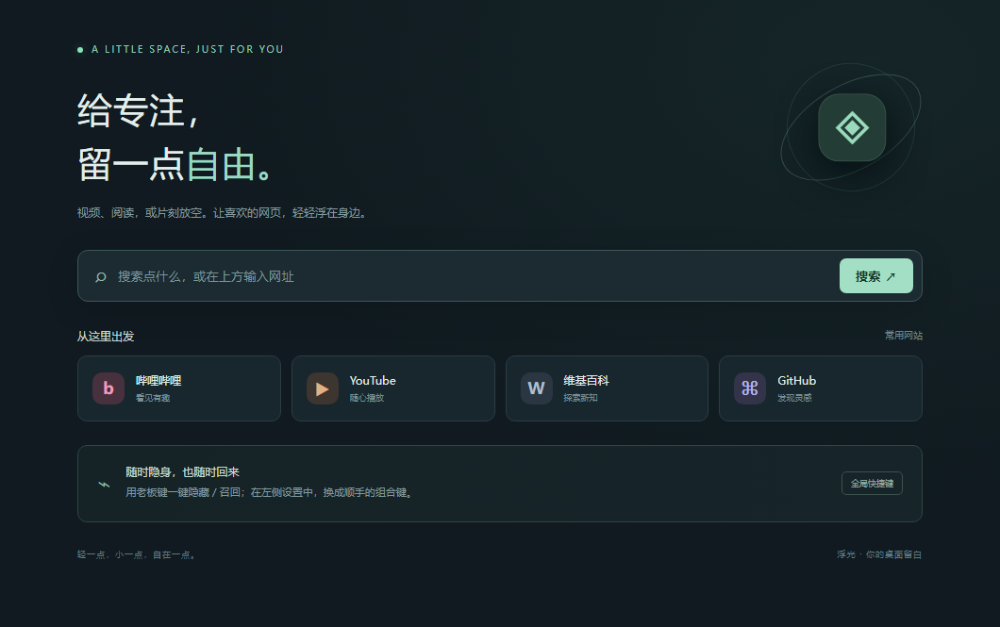

# 浮光 FloatBrowser

浮光像一扇能放在 Windows 桌面角落的小窗。比如，你想跟着视频学画画，就把视频放在画布旁边。你可以边看边画，不用来回切换。想看清整张画布时，按一下快捷键把小窗藏起来，再按一下，它就回来了。

**[下载浮光 · Windows 64 位版](https://github.com/Johnnylov/FloatBrowser/releases/latest)**



## 第一次怎么打开？

1. 点上面的下载链接，在下载页的 **Assets（附件）** 里找到 `FloatBrowser-1.0.11-win-x64.zip`。
2. 下载后，右键点这个压缩包，选择「全部解压」。打开解压出来的文件夹，双击 `FloatBrowser.exe`。以后也从这里打开，旁边的文件要和它放在一起。
3. 在起始页中间输入你想搜的内容。如果手里已经有网址，按 `Ctrl + L`，粘贴网址，再按回车。

浮光适用于 64 位 Intel 或 AMD 电脑，系统需要 Windows 10（2004 版或更新）或 Windows 11。如果打开时提示缺少 WebView2，那是浮光用来显示网页的组件，装好后再打开浮光即可。[从微软下载 WebView2 Evergreen Runtime](https://developer.microsoft.com/microsoft-edge/webview2/)

## 怎么把网页放在手边？

- **挪到角落。** 按住小窗顶部的空白处拖动。想让它小一点，就把窗口边缘往里拖。
- **让它留在最上面。** 打开「置顶」。这样你点回画布或笔记时，仍然看得见旁边的网页。
- **把字看清楚。** 点顶部的「工具」，调「缩放」可以把网页上的字放大。调「透明度」可以让整个小窗变淡，露出背后的内容。
- **临时藏起来。** 同时按住 `Ctrl` 和 `Alt`，再按 `Q`。用同样的按法就能找回小窗。忘了快捷键，也可以点 Windows 右下角的浮光图标把它叫回来。

## 藏起视频后，还想听声音怎么办？

浮光默认会在藏起窗口时尝试暂停视频。在「工具」里打开「后台继续播放」，再把小窗藏起来，就能接着听。要让所有小窗一起安静下来，右键点 Windows 右下角的浮光图标，选「全部暂停」。部分网站有自己的播放规则，可能需要在网页里手动点播放或暂停。

## 用到时再学的几个小招

| 你想做什么 | 可以这样做 |
| --- | --- |
| 留着教程，再打开另一个网页 | 按住 `Ctrl` 再点链接。最多可以留 5 个小窗；按 `Ctrl + Alt + ←` 或 `Ctrl + Alt + →` 在它们之间切换。 |
| 下次再看这个网页 | 点地址栏旁边的星星。下次打开「收藏」就能找到它。忘了收藏，也可以去「历史」找最近访问过的 50 个地址。 |
| 鼠标一离开，小窗就让开 | 在设置中打开「鼠标离开自动隐藏」。如果希望鼠标移回来时再出现，再打开「鼠标回到原区域时自动恢复」。 |
| 透过白色网页看桌面 | 在工具里试试「白底透明」。它会让白色或接近白色的网页底色透出来，照片和视频保留原样。如果某个网页看起来奇怪，关掉这个选项即可。 |

## 我的收藏和登录信息放在哪儿？

它们保存在你电脑上当前 Windows 用户的文件夹里。按 `Win + R`，输入 `%LOCALAPPDATA%\FloatBrowser`，再按回车，就能找到。换新版浮光时，解压新版并打开就好，它会接着使用这份资料。公开的下载包只装程序、图片和说明，你自己的 Cookie（网站用来记住你已登录的小记录）、收藏和浏览历史都保留在本机。

## 想自己从源码做出一个浮光？

如果你已经下载了上面的压缩包，双击就可以使用。下面几步留给想读代码、改代码的人。

1. 在 Windows 上安装 **.NET 8 SDK**。它是把源码做成可运行程序的工具。
2. 下载本仓库源码，在有 `FloatBrowser.csproj` 的文件夹里打开 PowerShell，运行下面这行命令。

```powershell
.\build.ps1
```

3. 打开生成的 `publish\win-x64` 文件夹，双击里面的 `FloatBrowser.exe`。

想检查程序，可以在刚才的 PowerShell 窗口运行下面这行。检查会使用一份单独的临时资料。

```powershell
.\verify.ps1 -Exe .\publish\win-x64\FloatBrowser.exe
```

**这个版本测过什么？** 已单独测过保存数据、后台播放，以及从标题栏和窗口列表关掉最后一个小窗。完整检查在验证「鼠标移回时重新显示小窗」时点错了设置项，因此这一项还没有验证通过。

## 我可以改代码或分享给别人吗？

可以。浮光的代码用 MIT 许可证发布，你可以使用、修改和分享，记得保留版权和许可声明。一同分发的第三方组件有各自的许可。[浮光的许可证](LICENSE) · [第三方声明](third-party)
